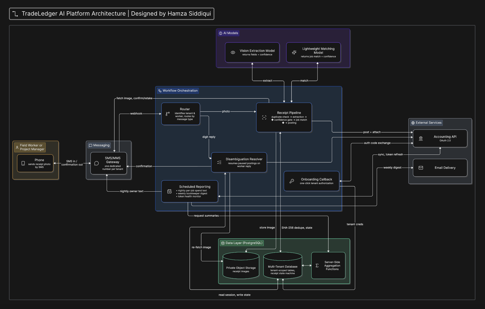
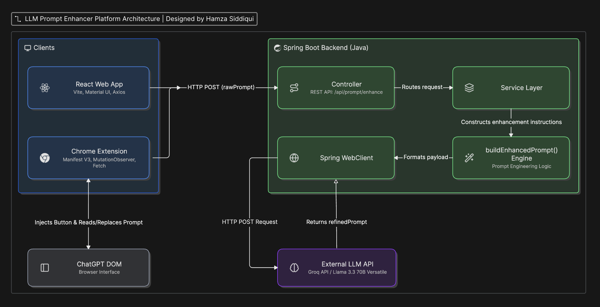

# 👋 Hi, I'm Hamza — Backend & Applied AI Engineer

🎓 Honours Computer Science @ WLU | Concentration in Big Data Systems

I build event-driven, multi-tenant systems that put LLMs into real workflows, with the guardrails that make them trustworthy.

---

## 🚀 What I've Built

### [TradeLedger AI](https://github.com/Siddiqui-Hamza/tradeledger-architecture)
SMS-based receipt capture for trade contractors. A field worker texts a receipt photo; the platform extracts the data with LLM vision, matches it to the right job, and posts a coded transaction to QuickBooks Online with the original image attached.

*   **Reliability:** Confidence-gated extraction that holds uncertain receipts instead of posting bad data, triggering a human-in-the-loop SMS disambiguation loop.
*   **Data Integrity:** 7-table multi-tenant PostgreSQL schema with partial/composite unique indexes and SHA-256 image hashing for strict idempotent ingestion.
*   **Infrastructure:** 10-state receipt lifecycle, database-side PL/pgSQL JSON aggregations (native weekly spend computations), and Intuit OAuth 2.0 token lifecycle management.

> 

> 
<kbd> 🖼️ View System Architecture Diagram </kbd>

>  
> <a href="https://github.com/Siddiqui-Hamza/tradeledger-architecture">
> 
> </a>
> 

### [LLM Prompt Enhancer](https://github.com/Siddiqui-Hamza/ai-prompt-enhancer)
A full-stack AI platform that seamlessly injects a native enhancement engine directly into the ChatGPT interface. It automatically reads raw inputs and replaces them with highly structured, LLM-optimized prompts without forcing the user to switch tabs.

*   **Frontend Engineering:** Bypassed complex React hydration conflicts using a debounced `MutationObserver` with idempotent injection guards to keep the UI persistent across ChatGPT's DOM mutations.
*   **Architecture:** A centralized Spring Boot REST API concurrently serving a standalone React/Vite dashboard and the Manifest V3 Chrome Extension.

> 

> 
<kbd> 🖼️ View System Architecture Diagram </kbd>

>  
> <a href="https://github.com/Siddiqui-Hamza/ai-prompt-enhancer">
> 
> </a>
> 

---

## 🌱 Currently Building
- Automated financial news sentiment ETL pipeline (Python, PySpark, PostgreSQL)
- Distributed data processing & cloud infrastructure (Docker, Hadoop)

---

## ⚙️ Stack

### Languages & Databases

### Backend, Big Data & AI

### Infrastructure & APIs

